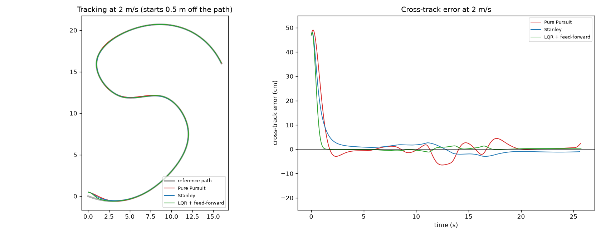

# Path Tracking for a Car-Like Robot: Pure Pursuit vs. Stanley vs. LQR



A kinematic bicycle model (0.5 m wheelbase, ±30° steering limit, 0.1 s steering lag) follows a 51 m spline path with tight S-bends (max curvature 0.39 1/m). The robot starts 0.5 m off the path. I implemented three classic lateral controllers and scored them on cross-track error, heading error, settling time and steering effort, at three speeds and with noisy localization.

## Results

Errors are measured against the true pose and exclude the first 2 s, while the robot is still converging from the 0.5 m offset. Settle time is how long the error takes to drop below 5 cm.

| Scenario | Controller | Settle | RMS CTE | Max CTE | Steer rate |
|---|---|---|---|---|---|
| 2 m/s | Pure Pursuit | 1.46 s | 2.2 cm | 6.5 cm | 2.7 °/s |
| 2 m/s | Stanley | 1.76 s | 1.6 cm | 3.8 cm | 3.9 °/s |
| 2 m/s | **LQR + feed-forward** | **0.84 s** | **0.5 cm** | **1.4 cm** | 5.1 °/s |
| 3 m/s | Pure Pursuit | 1.30 s | 4.9 cm | 14.8 cm | 3.1 °/s |
| 3 m/s | Stanley | 1.50 s | 1.1 cm | 2.6 cm | 5.1 °/s |
| 3 m/s | LQR + feed-forward | 0.52 s | 0.8 cm | 2.1 cm | 7.9 °/s |
| 2 m/s, noisy pose | Pure Pursuit | 1.44 s | 2.2 cm | 6.1 cm | 8.8 °/s |
| 2 m/s, noisy pose | Stanley | 1.80 s | 1.8 cm | 4.3 cm | 19.4 °/s |
| 2 m/s, noisy pose | LQR + feed-forward | 0.82 s | 0.8 cm | 2.9 cm | 25.4 °/s |

Pose noise: σ = 3 cm in position and 1° in heading, at every 50 Hz control step.

## What I learned

- **LQR with curvature feed-forward** had the lowest error at every speed (77% lower RMS error than Pure Pursuit at 2 m/s) and settled fastest, because the feed-forward term steers into each curve before any error builds up.
- **Pure Pursuit** is simple and smooth but cuts corners as speed rises: its maximum error more than doubled from 2 to 3 m/s (6.5 to 14.8 cm).
- **Noise is the trade-off.** With noisy localization, LQR and Stanley react to every jump in the measured pose, so they used about 3x and 2x the steering rate of Pure Pursuit. On a real robot, that means filtering the pose (for example with an EKF) or lowering the gains.

## How it works

- **Model:** kinematic bicycle, `x' = v cos θ`, `y' = v sin θ`, `θ' = v tan δ / L`, with a first-order steering lag.
- **Pure Pursuit:** steers toward a look-ahead point `ld = 0.6 v + 0.4` m ahead on the path.
- **Stanley:** heading error plus `atan(k e / v)`, measured at the front axle.
- **LQR:** discrete-time Riccati solution on the lateral error model `[e, θ_e]`, plus a feed-forward term `atan(L κ)` from the path curvature.

## Run it

```bash
python3 -m venv .venv && source .venv/bin/activate
pip install -r requirements.txt
python3 path_tracking.py            # prints the table and saves tracking.png
python3 path_tracking.py --seed 3   # different noise sequence
```
